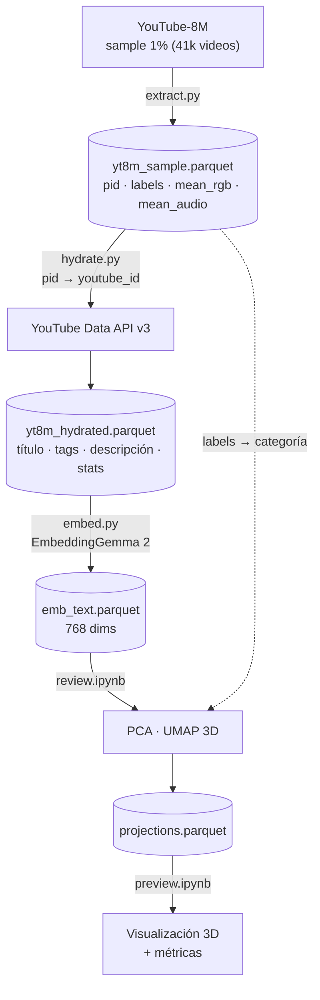

## YouTube-8M + YouTube Data API v3

La idea: meter videos de YouTube en un espacio vectorial, ver cómo se agrupan por tema y (más adelante, ójala, usarlo para encontrar videos **fuera de tus recomendaciones**.)

Usamos dos fuentes:

1.  [**YouTube-8M**](https://research.google.com/youtube8m/) (Google, v2 2018): \~6,1M videos con features visuales/audio ya calculadas (`mean_rgb`, `mean_audio`) y etiquetas temáticas. Los IDs vienen anonimizados.
2.  [**YouTube Data API v3**](https://developers.google.com/youtube/v3): título, descripción, tags, vistas, miniatura, etc.

Del train de YT-8M bajamos un sample de **\~1%** (41 shards, 41.393 videos). Cada video trae un `pid` anonimizado, que traducimos al ID real de YouTube para pedir su metadata a la API. Con el texto (título + tags + descripción) generamos embeddings con [EmbeddingGemma 2](https://huggingface.co/google/embeddinggemma-2) y los proyectamos en 3D.



### Los archivos

- `extract.py`: lee los `.tfrecord` de YT-8M y los pasa a `data/yt8m_sample.parquet`.
- `hydrate.py`: traduce `pid` → `youtube_id` y pide la metadata a la API → `data/yt8m_hydrated.parquet`.
- `embed.py`: arma el texto de cada video y lo embebe con EmbeddingGemma 2 → `data/emb_text.parquet`.
- `review.ipynb`: el paso a paso: exploración, PCA, UMAP, métricas → `data/projections.parquet`.
- `preview.ipynb`: para ver los resultados directo, sin recalcular nada.

### El embudo de datos

| Etapa                    | Videos             |
| ------------------------ | ------------------ |
| Sample YT-8M             | 41.393             |
| Con ID real de YouTube   | 37.230 (89,9%)     |
| Todavía vivos en YouTube | **34.788 (84,0%)** |

### Cómo correrlo

```bash
# 1. entorno
uv venv --python 3.12 .venv && uv pip install -p .venv -r requirements.txt

# 2. API key de YouTube (Google Cloud → habilitar "YouTube Data API v3" → crear API key)
echo 'YOUTUBE_API_KEY=tu_key' > .env

# 3. bajar el sample (1/100 del train)
mkdir -p data/yt8m/video/train && cd data/yt8m/video/train
curl data.yt8m.org/download.py | shard=1,100 partition=2/video/train mirror=us python3
cd -

# 4. pipeline
.venv/bin/python extract.py
.venv/bin/python hydrate.py     # ~10 min, ~750 unidades de cuota
.venv/bin/python embed.py       # ~30 min en un M2
```

### próximos pasos
